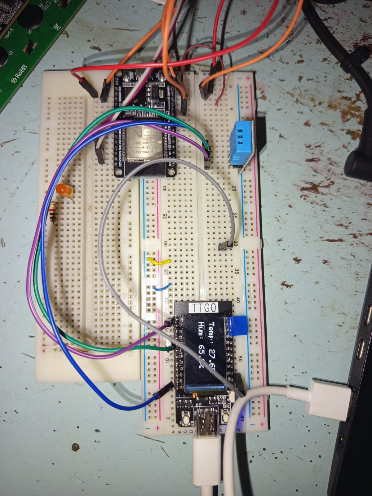
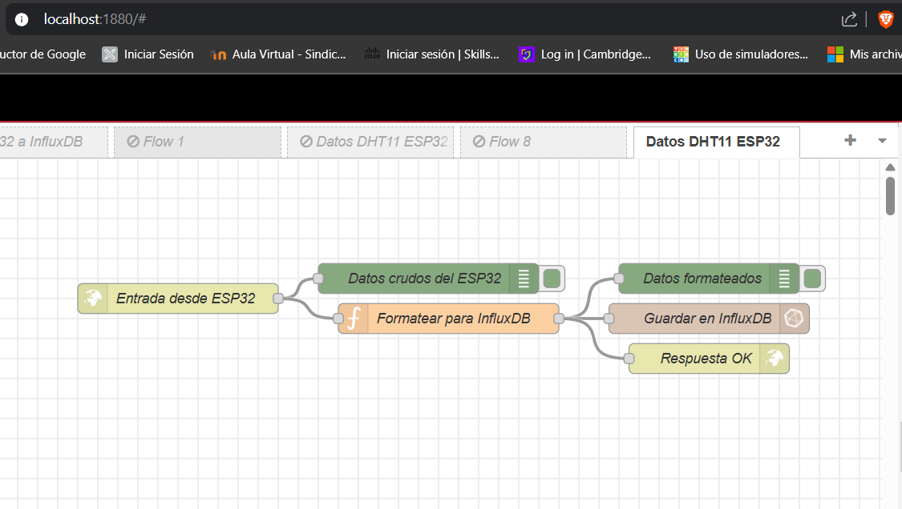
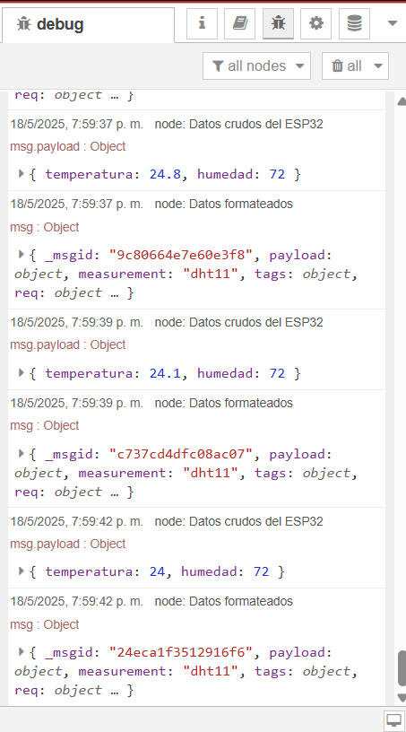
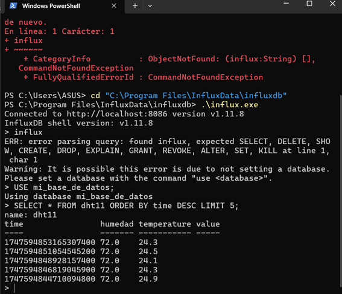
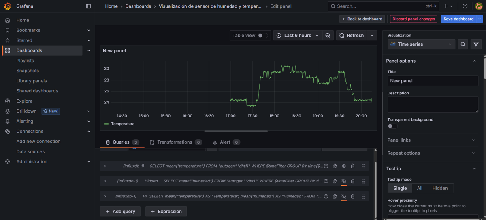
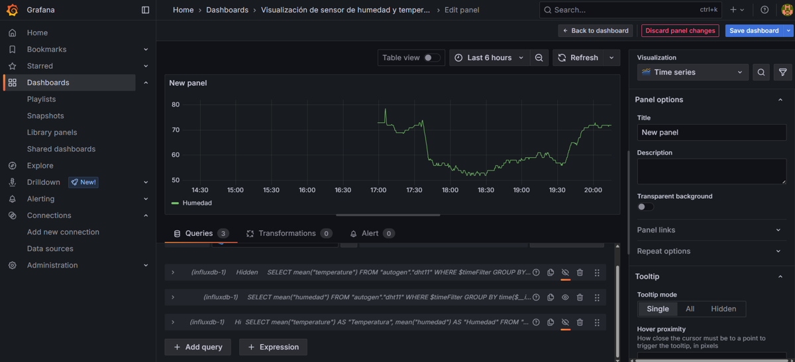

# Monitoreo IoT de temperatura y humedad — ESP32 + DHT11 + Node-RED + InfluxDB + Grafana

Sistema IoT de extremo a extremo que mide temperatura y humedad con un **DHT11**, las muestra en la pantalla de una **LilyGO TTGO T-Display (ESP32)** y las envía por **HTTP POST** a **Node-RED**. Node-RED las guarda en **InfluxDB 1.x**, y **Grafana** las grafica en tiempo real.

> Proyecto académico: examen del primer bimestre de *Internet de las Cosas*, Ingeniería en Telecomunicaciones, Universidad Técnica del Norte (UTN).



## Arquitectura

```
┌──────────────┐  GPIO17  ┌────────────────────┐  HTTP POST /dht   ┌──────────┐  line protocol  ┌──────────┐  InfluxQL  ┌─────────┐
│ DHT11        │ ───────► │ ESP32 TTGO T-Display│ ────────────────► │ Node-RED │ ──────────────► │ InfluxDB │ ─────────► │ Grafana │
│ (temp / hum) │          │ (pantalla TFT 1.14")│   JSON  :1880     │          │      :8086      │   1.x    │            │  :3000  │
└──────────────┘          └────────────────────┘                    └──────────┘                 └──────────┘            └─────────┘
```

Payload enviado por el ESP32 cada 2 s:

```json
{ "temperatura": 24.1, "humedad": 72.0 }
```

## Estructura del repositorio

```
.
├── firmware/esp32_dht11_nodered/
│   ├── esp32_dht11_nodered.ino   # Sketch de Arduino para el ESP32
│   └── secrets.example.h         # Plantilla de credenciales WiFi / URL del servidor
├── node-red/
│   └── flow.json                 # Flujo importable en Node-RED
└── docs/img/                     # Capturas del montaje y de la configuración
```

## Hardware

| Componente | Detalle | Costo aprox. (USD) |
|---|---|---|
| LilyGO TTGO T-Display ESP32 | ESP32 + LCD SPI 1.14" | 28.00 |
| Sensor DHT11 | Temperatura (°C) y humedad relativa (%) | 3.50 |
| Cable micro USB | Programación y alimentación | 2.00 |
| Jumpers | — | 1.00 |
| **Total** | | **34.50** |

**Conexión DHT11 → ESP32:** VCC → 3V3, GND → GND, DATA → **GPIO17**. La retroiluminación del TFT se habilita con GPIO4.

## Software

- Arduino IDE con el core ESP32 y las librerías `DHT sensor library` (Adafruit), `TFT_eSPI` (configurada para TTGO T-Display, `Setup25_TTGO_T_Display.h`), `WiFi` y `HTTPClient`.
- Node.js + Node-RED, con el nodo `node-red-contrib-influxdb`.
- InfluxDB 1.x (probado con v1.11.8).
- Grafana.

## Puesta en marcha

### 1. InfluxDB

```sql
influx
> CREATE DATABASE mi_base_de_datos
> SHOW DATABASES
```

### 2. Node-RED

1. Instalar el nodo de InfluxDB: *Manage palette → Install →* `node-red-contrib-influxdb`.
2. *Menú → Import →* seleccionar `node-red/flow.json` → *Deploy*.

El flujo:

| Nodo | Función |
|---|---|
| `http in` (POST `/dht`) | Recibe el JSON del ESP32 |
| `function` *Formatear para InfluxDB* | Valida y convierte a `float`; measurement `dht11`, tag `origen=ESP32` |
| `influxdb out` | Escribe en `mi_base_de_datos` (`localhost:8086`) |
| `http response` | Devuelve `200 OK` al ESP32 |
| `debug` ×2 | Datos crudos y formateados |



### 3. Firmware ESP32

```bash
cd firmware/esp32_dht11_nodered
cp secrets.example.h secrets.h   # completar SSID, contraseña e IP de la PC con Node-RED
```

Abrir `esp32_dht11_nodered.ino` en Arduino IDE, seleccionar la placa ESP32 y cargar. En el monitor serie (115200 baudios) debe aparecer `Código de respuesta HTTP: 200`.

### 4. Grafana

1. Abrir `http://localhost:3000`.
2. *Connections → Data sources → InfluxDB*: URL `http://localhost:8086`, base de datos `mi_base_de_datos`, método `GET`.
3. Crear un dashboard con dos paneles (actualización cada 5 s):

```sql
SELECT mean("temperature") FROM "dht11" WHERE $timeFilter GROUP BY time($__interval) fill(none)
SELECT mean("humedad")     FROM "dht11" WHERE $timeFilter GROUP BY time($__interval) fill(none)
```

## Resultados

| Datos en Node-RED | Consulta en InfluxDB |
|---|---|
|  |  |

| Temperatura en Grafana | Humedad en Grafana |
|---|---|
|  |  |

Video de la práctica: <https://youtu.be/zMsoSeNWwaU>

## Problemas encontrados y soluciones

| Problema | Causa | Solución |
|---|---|---|
| Lecturas `NaN` o erráticas | Pin de datos mal conectado / `DHTTYPE` incorrecto (DHT11 vs DHT22) | Corregir conexión y tipo; respetar ≥2 s entre lecturas |
| WiFi intermitente | Credenciales incorrectas | Verificar SSID y contraseña |
| POST sin respuesta | Node-RED detenido o endpoint mal definido | Node-RED activo en `:1880`, ruta exacta `/dht` |
| Error al escribir en InfluxDB | Base de datos no creada | `CREATE DATABASE` antes de iniciar el flujo |
| Paneles vacíos en Grafana | Consulta InfluxQL mal escrita | Seleccionar measurement `dht11` y el campo correcto |

## Mejoras posibles

- Reconexión automática a WiFi y reintentos ante errores HTTP.
- Migrar el transporte a MQTT (menor overhead que HTTP para telemetría).
- Sustituir el DHT11 por un DHT22/SHT31 para mayor precisión.

## Autor

**Alexis Méndez** — Ingeniería en Telecomunicaciones, UTN (Ibarra, Ecuador).
Docente: MSc. Edgar Maya · Técnica de laboratorio: MSc. Alejandra Pinto Erazo.

## Licencia

[MIT](LICENSE)
